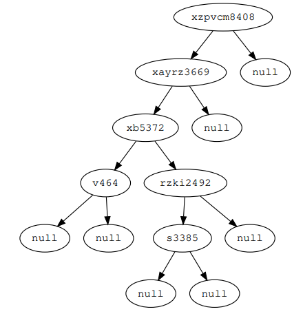

Challenge created by João Batista de Oliveira - PUCRS

Solution developed by Daniela Rigoli

# Description of the Problem

After obtaining access to confidential Greenpeace documents, you discover that their secrets are stored as binary trees (which makes sense, after all, Greenpeace likes trees).

To make espionage more difficult, they always store two representations of each tree: one using **preorder traversal** and another using **inorder traversal**. These traversals are stored separately and in different locations, making it impossible to decode the information without both.

Through an electronic intelligence operation, you manage to obtain both sets of traversal data. Your task is to analyze a pair of sequences describing a binary tree and answer the following question:

## What is the height of the binary tree described by these traversals?

The input consists of exactly two lines:
- The first line contains the preorder traversal of the tree.
- The second line contains the inorder traversal of the tree.

The example below represents the binary tree shown in the original problem statement. Note that null values are not included in either traversal. Since null nodes are also excluded when calculating the height, the height of this example is **4**.

# Solution
The solution is implemented in main.py, located in the same directory as this document.

The implementation consists of two methods using recursion: height() and _height().

# How the Algorithm Works

As a way to validate the results, an initial implementation was developed to reconstruct the binary tree using the two traversal sequences. This approach compares the preorder and inorder traversals to identify the root and determine the structure of the left and right subtrees.

However, reconstructing the entire tree is unnecessary for this challenge. Since the objective is only to calculate its height, the final solution uses a recursive approach that determines the height directly from the traversal sequences.

The implementation in main.py works as follows:
1. height(lines): This is the entry-point method. It checks whether the input is empty and initializes the recursive calculation by calling _height().
2. _height(lines, a, c, qt): This method performs the recursive calculation. It receives the traversal sequences and the boundaries needed to identify the current subtree.
3. Root identification: The first element of the current preorder segment represents the subtree's root. The method uses lines[1].index(lines[0][a]) to locate that root in the inorder traversal.
4. Subtree division: The root's position in the inorder traversal determines which elements belong to the left and right subtrees.
5. Recursive calculation: The method calls itself to calculate the height of both subtrees.
6. Height determination: Finally, it returns the maximum height between the two subtrees, adding one for the current root.

This approach avoids explicitly creating tree nodes and calculates the height directly from the traversal information.

# Results

| Caso                | Duration         | Height |
| ------------------- | ---------------- | ------ |
|  casos/casoa15.txt  |  0:00:00.000041  | 2      |
|  casos/casoa18.txt  |  0:00:00.000048  | 3      |
|  casos/casoa20.txt  |  0:00:00.000061  | 6      |
|  casos/casoa25.txt  |  0:00:00.000077  | 8      |
|  casos/casoa30.txt  |  0:00:00.000238  | 11     |
|  casos/casoa40.txt  |  0:00:00.000292  | 14     |
|  casos/casoa50.txt  |  0:00:00.000533  | 12     |
|  casos/casob15.txt  |  0:00:00.000043  | 3      |
|  casos/casob18.txt  |  0:00:00.000065  | 7      |
|  casos/casob20.txt  |  0:00:00.000035  | 3      |
|  casos/casob25.txt  |  0:00:00.000079  | 7      |
|  casos/casob30.txt  |  0:00:00.000117  | 11     |
|  casos/casob40.txt  |  0:00:00.001124  | 16     |
|  casos/casob50.txt  |  0:00:00.000626  | 13     |
